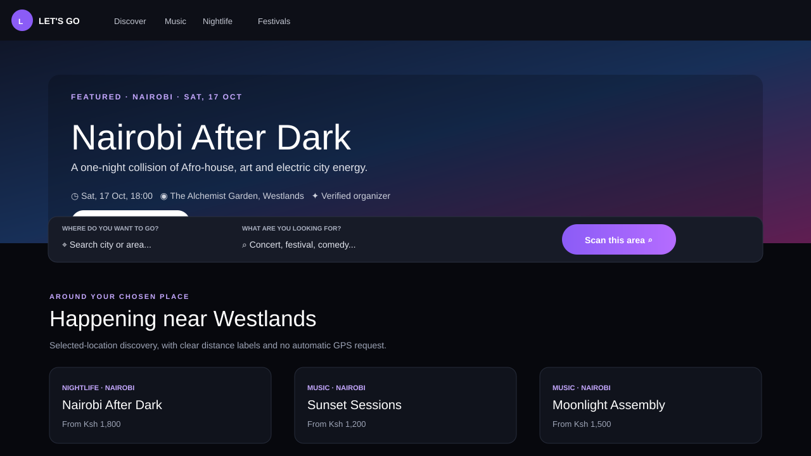
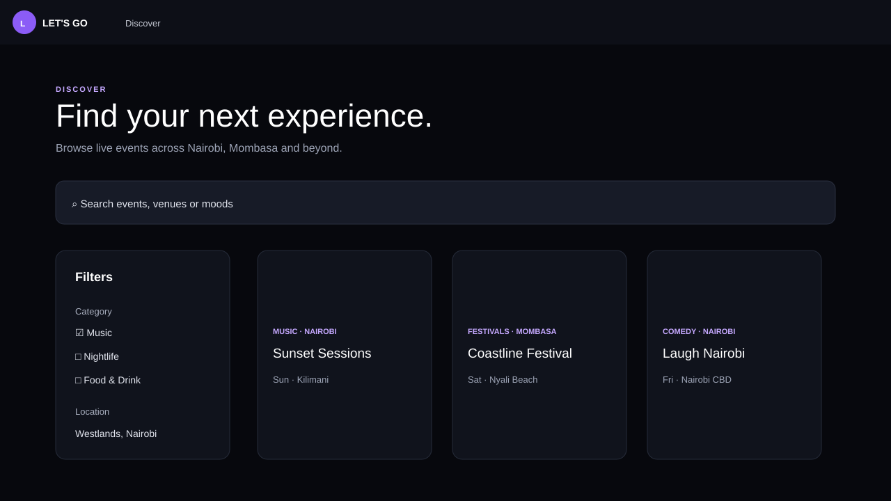
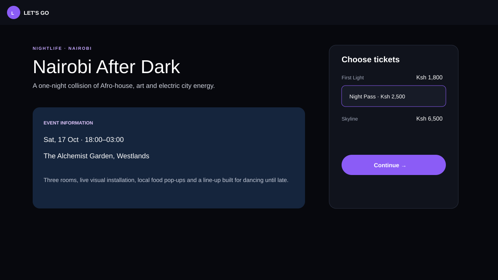

# Let's Go Event

A Kenya-focused event discovery and ticketing platform built with Next.js, NestJS, and Django. Discover nearby experiences, browse event details and ticket tiers, and manage an editorial event catalogue.

## Screenshots

### Event discovery



### Explore events



### Event details



Screenshots show the local development application and its sample catalogue.

## Features

- Event discovery by location, category, and mood, with map-based browsing.
- Event pages with venue information, schedules, and ticket tiers.
- Order and ticket flows backed by the Django catalogue, plus a ticket validation app.
- Django editorial tools for organizers, venues, artwork, and event publishing.
- Let's Go Radar: source registration, event ingestion, normalization, duplicate review, and controlled publication.
- Organizer and operations dashboard prototypes with sample data.

This is a development project. Sample listings and dashboard metrics are included; payment-provider configuration and production hardening require additional setup.

## Project structure

| Directory | Purpose |
| --- | --- |
| `apps/web` | Next.js customer website |
| `apps/api` | NestJS event discovery API |
| `apps/django_admin` | Django catalogue, orders, tickets, editorial admin, and Radar |
| `apps/organizer` | Organizer dashboard prototype |
| `apps/admin` | Operations dashboard prototype |
| `apps/scanner` | Ticket validation interface |
| `packages/types` | Shared TypeScript types |
| `packages/validation` | Shared validation schemas |
| `packages/database` | Prisma schema and database tooling |

## Run locally

Use Node.js 24 or newer and pnpm 11.4.0. The Django service also requires Python and the dependencies in its requirements file.

```sh
pnpm install
pnpm dev
```

To run only the customer website:

```sh
pnpm --filter @letsgo/web dev
```

The website falls back to a bundled sample catalogue when Django is unavailable. For editorial publishing, orders, and ticket validation, follow the [Django setup guide](apps/django_admin/README.md) in a separate terminal. Create your own administrator credentials during setup.

| Service | Local URL |
| --- | --- |
| Customer website | http://127.0.0.1:3000/ |
| Organizer dashboard | http://127.0.0.1:3001/ |
| Operations dashboard | http://127.0.0.1:3002/ |
| Ticket scanner | http://127.0.0.1:3003/ |
| Nest API documentation | http://127.0.0.1:4000/docs |
| Django admin | http://127.0.0.1:8000/admin/ |
| Django catalogue API | http://127.0.0.1:8000/api/events/ |

See [.env.example](.env.example) for configuration names and local defaults. Provide variables to the relevant process or its supported environment file; Django reads environment variables directly. SQLite is the default Django database. Optional PostgreSQL and Redis services are defined in [docker-compose.yml](docker-compose.yml).

## Development commands

```sh
pnpm typecheck
pnpm lint
pnpm build
pnpm test
```

Run Django checks and tests from `apps/django_admin` with its virtual environment active:

```sh
python manage.py check
python manage.py test events radar
```

## Documentation

- [Django setup and publishing](apps/django_admin/README.md)
- [Radar architecture](docs/RADAR.md)
- [Radar operations](docs/RADAR_OPERATIONS.md)
- [Radar source management](docs/RADAR_SOURCES.md)

Local credentials, databases, uploaded media, dependency folders, and generated build output are excluded from Git.
